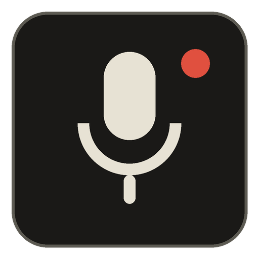
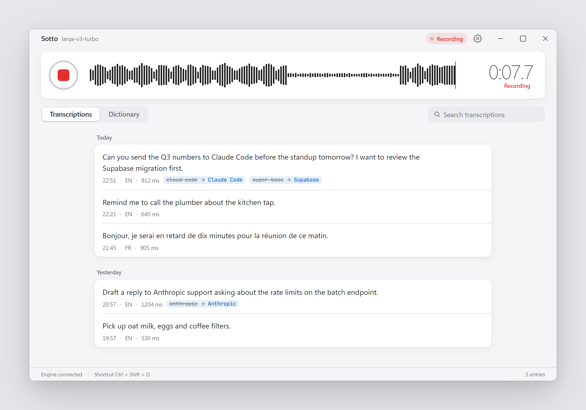
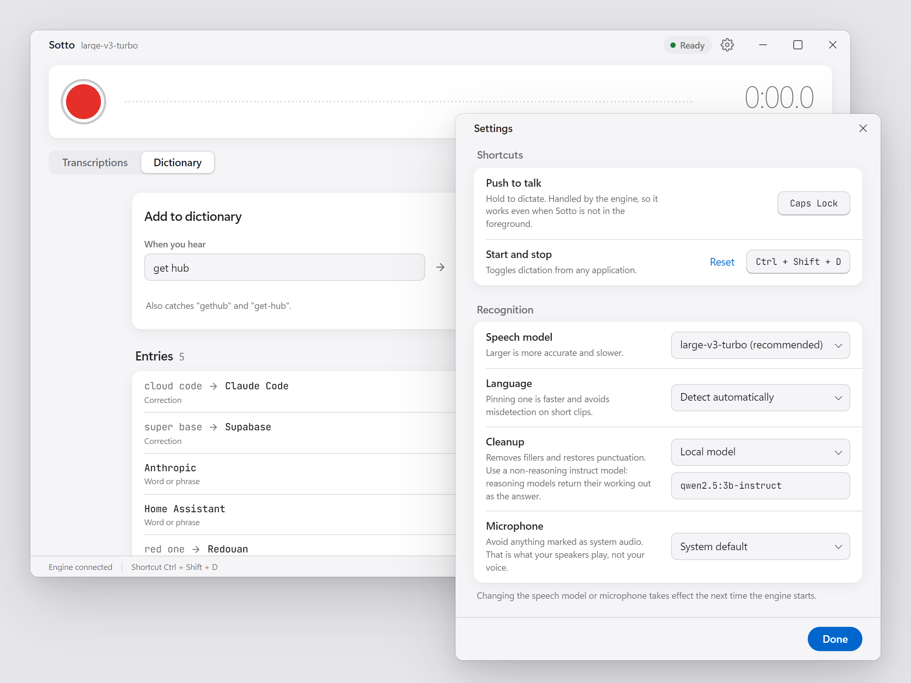
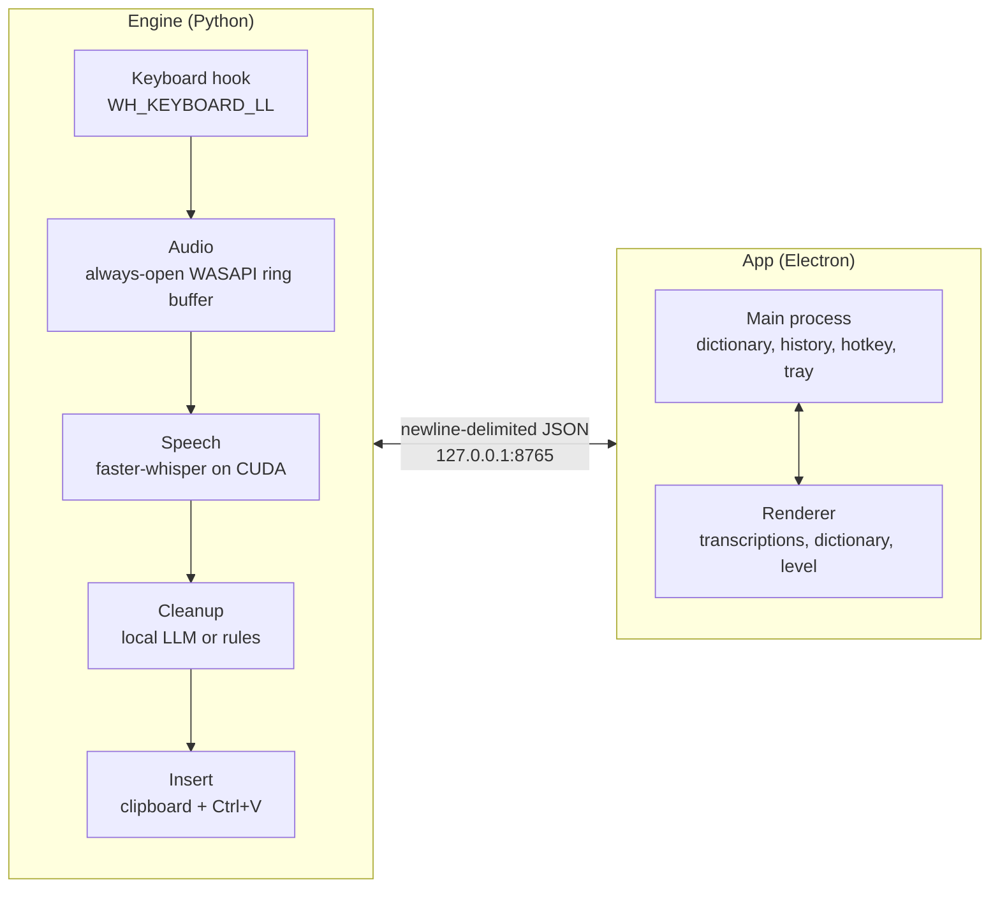

<p align="center">
  
</p>

<h1 align="center">Sotto</h1>

<p align="center">
  <strong>Local push-to-talk dictation for Windows.</strong><br>
  Hold a key, speak, and polished text lands wherever your cursor is, in any app.
</p>

<p align="center">
  
  
  
  
</p>

<p align="center">
  <a href="#install">Install</a> ·
  <a href="#how-it-works">How it works</a> ·
  <a href="#the-dictionary">Dictionary</a> ·
  <a href="#build-from-source">Build</a> ·
  <a href="CHANGELOG.md">Changelog</a>
</p>

<br>

<picture>
  <source media="(prefers-color-scheme: dark)" srcset="docs/images/hero-dark.png">
  
</picture>

Everything runs on this machine. No API keys, no subscription, no audio
leaving the box.

## Highlights

- **Works in every app.** Text is inserted at the cursor in whatever window
  has focus: an editor, a browser, chat, email.
- **Push to talk or toggle.** Hold a key you never type with (Caps Lock by
  default), or start and stop with a global shortcut.
- **Fast, accurate speech.** faster-whisper `large-v3-turbo` on your NVIDIA GPU.
- **Cleanup without the cloud.** A small local model through Ollama removes
  filler words and restores punctuation. A rules-only fallback needs nothing
  extra.
- **A dictionary that actually sticks.** Teach it names and jargon. Terms bias
  recognition, and a correction pass guarantees the spelling you want.
- **Stays out of the way.** Lives in the tray, starts with Windows if you
  want, and shows a small floating pill while it listens.
- **Looks at home.** Follows the Windows light and dark setting.

## A closer look

<picture>
  <source media="(prefers-color-scheme: dark)" srcset="docs/images/windows-dark.png">
  
</picture>

<p align="center"><sub>The dictionary shows what each correction will also catch. Settings are grouped by shortcuts, recognition and application.</sub></p>

<br>

<p align="center">
  
</p>

<p align="center"><sub>While you dictate into another app, a floating pill shows that Sotto is listening. It never takes focus and clicks pass straight through it.</sub></p>

## Install

1. Download **`Sotto-Setup-0.2.0.exe`** from
   [Releases](../../releases/latest) and run it.
2. Launch Sotto from the Start menu or the desktop shortcut.
3. Hold **Caps Lock** and speak. Release to insert the text.

The first launch downloads the speech model (about 1.6 GB), so the first
dictation takes a few minutes to become available.

The installer is not code-signed yet. If Windows SmartScreen shows
*Windows protected your PC*, choose **More info → Run anyway**.

### Requirements

| | |
|---|---|
| **OS** | Windows 10 or 11, 64-bit |
| **GPU** | NVIDIA with CUDA 12 support |
| **Cleanup (optional)** | [Ollama](https://ollama.com) with `qwen2.5:3b-instruct` pulled |

Without Ollama, set **Cleanup** to *Rules only* in Settings. Sotto still
removes common filler words.

## How it works

Two processes with a hard boundary between them.



- The engine has no dependency on the app. Dictation keeps working with the
  window closed, and the app reconnects on its own whenever the engine
  restarts.
- The dictionary correction pass runs in the app's main process, before the
  engine inserts the text.
- The renderer runs with `contextIsolation` on and `nodeIntegration` off. Its
  entire capability surface is the named calls in `electron/preload.js`.

## Using Sotto

| To | Do this |
|---|---|
| Dictate | Hold **Caps Lock**, speak, release |
| Start and stop hands-free | Press **Ctrl + Shift + D**, or the record button |
| Copy or delete a past dictation | Hover it in *Transcriptions* |
| Search | **Ctrl + F** |
| Change keys, model, language or microphone | The gear icon, top right |
| Quit | Tray icon → *Exit*, or **Ctrl + Q**. Closing the window only hides it |

## The dictionary

Teach it names and jargon it keeps getting wrong. Two entry types:

- **Word or phrase**: "Anthropic", "Supabase". Feeds the bias list.
- **Correction**: when you hear *X*, write *Y*. Feeds both.

Both mechanisms run, because one alone is not enough.

**Biasing** hands your terms to Whisper as context so it leans toward
producing them. It is a nudge, not a promise, and the list is capped at 40
terms or 320 characters: a long prompt makes Whisper drift and invent text
on quiet audio.

**The correction pass** is the guarantee. Whole-word, case-insensitive,
longest match first, applied in the main process before the engine inserts.

Multi-word entries match glued and hyphenated forms, because speech models
produce those unpredictably. `cloud code` compiles to
`\bcloud[\s-]*code\b`, which catches *cloud code*, *CloudCode* and
*Cloud-Code*, and cannot touch *Cloudflare*, the bare word *cloud*, or
*cloud coder*. Entries that would rewrite ordinary speech get a warning
before you save them.

The file is plain JSON at `%APPDATA%\Sotto\dictionary.json`, editable by
hand. The app watches it and reloads on change, and every write re-reads
from disk first, so a hand edit is never clobbered by a stale in-memory
copy.

## Privacy

- Audio is captured, transcribed and cleaned up on this PC. It never leaves
  the machine.
- The only network use is the one-time speech model download on first run.
  There is no telemetry and no update check.
- The engine listens on the loopback address only (`127.0.0.1`).
- Settings, history and the dictionary live in `%APPDATA%\Sotto`.

## Build from source

Engine, once:

```
py -3.11 -m venv .venv
.venv\Scripts\pip install -r core\requirements.txt
ollama pull qwen2.5:3b-instruct
```

App:

```
cd shell
npm install
npm run dist
```

The installer lands in `dist\`. For development, run the engine with
`sotto.bat` and the app with `npm start` from `shell`. Only one engine can
run at a time: a second one exits with a message rather than silently
stacking.

Run the dictionary correction tests with:

```
cd shell && npm test
```

### Project layout

```
core/sotto/          the engine
  hotkey.py          low-level keyboard hook, own message pump
  audio.py           always-open capture, ring buffer, resampling
  stt.py             faster-whisper (CTranslate2) on CUDA
  polish.py          local LLM cleanup, rules fallback
  inject.py          clipboard + SendInput
  ipc.py             loopback transport, exclusive port bind
  engine.py          state machine
shell/
  electron/
    main.js          windows, menu, tray, global shortcut, IPC
    dictionary.js    store + correction engine
    core-client.js   engine transport
    history.js       transcription history
    window-state.js  geometry persistence
  renderer/
    tokens.css       the design system: every value in the UI
    fonts.css        bundled JetBrains Mono (UI uses the system face)
    index.html       main window
    settings.html    settings window
    indicator.html   floating recording indicator
```

### Design

`renderer/tokens.css` is the whole design system: colour, type scale,
spacing, radius, elevation, motion. Components pull from it; no literal
values in views. The reference is Apple's product language (the `apple`
DESIGN.md from awesome-design-md): neutral surfaces, grouped cards, one
interactive blue, and red reserved for "capturing your voice".

The app follows the Windows light/dark setting. Every colour token has a
dark counterpart, and `main.js` repaints the native title bar buttons when
the setting changes. The floating recording indicator is always dark so it
reads over any application.

UI text uses the system face (Segoe UI Variable on Windows 11). Only
JetBrains Mono is bundled, for dictionary patterns and shortcut keycaps.
Nothing is fetched at runtime.

## Troubleshooting

**The Fn key cannot be bound.** It is handled in keyboard firmware and
never reaches Windows. Compact boards often drop Right Ctrl too. Caps Lock
is the best default, and F13 to F24 from a Stream Deck or programmable
keyboard is better still. Avoid Right Alt on a Belgian or French layout: it
is AltGr, and binding it costs you `@`, `#`, `€`, `[` and `]`.

**Two different hotkeys.** Push-to-talk is held and belongs to the engine's
keyboard hook. The global toggle is a normal accelerator registered with
Windows through `globalShortcut`; if another application already owns the
combination, the status bar says so.

**Clipboard.** Paste injection stashes and restores `CF_UNICODETEXT`. Other
formats on the clipboard at dictation time are lost. Set `inject_method`
to `"type"` to avoid the clipboard entirely, at the cost of speed.

**CUDA libraries.** `nvidia-cublas-cu12` and `nvidia-cudnn-cu12` unpack
into `site-packages/nvidia/*/bin`, which Windows does not search.
`stt.register_cuda_dlls()` puts them on the search path; without it
CTranslate2 loads fine and then fails on the first GPU call.

**It cannot hear me.** In Settings → Microphone, pick your actual
microphone. Entries marked *system audio* are what your speakers play.

---

<p align="center"><sub>© 2026 Redouan Ahaddad. All rights reserved.<br>Screenshots show sample data.</sub></p>
